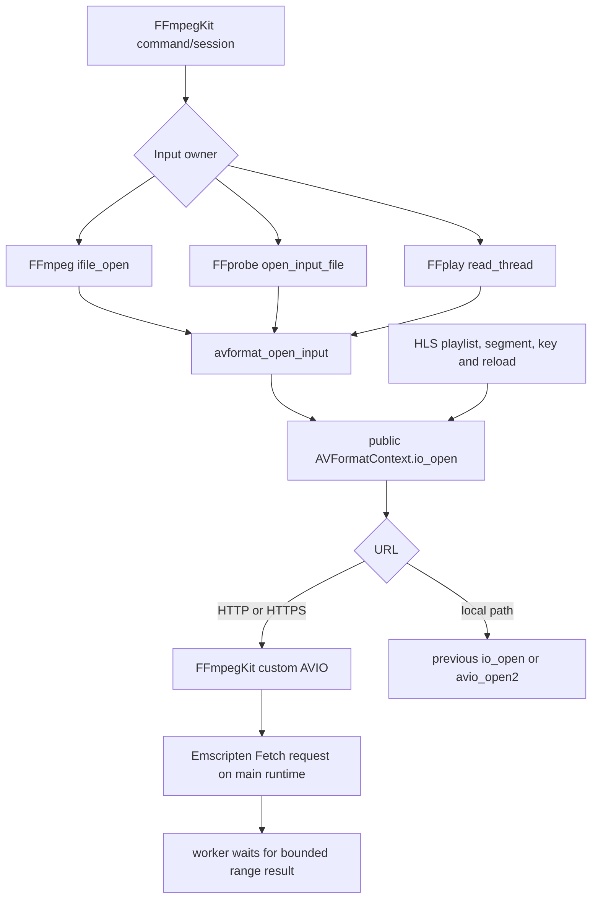

# Wasm streaming input design

> **Status:** Phase 1 is IN PROGRESS. The authoritative status of every goal, work item, case and gate is in [`PHASE-1-STATUS.md`](PHASE-1-STATUS.md); dated evidence is in [`PHASE-1-CURRENT-STATE-2026-10-14.md`](PHASE-1-CURRENT-STATE-2026-10-14.md). This document is authoritative for **design and contracts** only. Every dated status paragraph and status table below is a superseded snapshot.

*Superseded checkpoint notes, kept for history:*

**Request-lifetime checkpoint (2026-10-14 17:45 UTC):** HTTP-IO-4/5 are implemented and passed the stalled-main timeout/cancellation, forced close enqueue failure, full transport, decode and HLS VOD tests on the assertion/stack-check diagnostic with 256 KiB pthread stacks. See [the current-state evidence record](PHASE-1-CURRENT-STATE-2026-10-14.md) for exact hashes, scope and the preserved failed harness-report attempt. Phase 1 remains open for HTTP-IO-6, owner dispositions, remaining audio/metadata cases, total-memory evidence and closing release verification. Older continuation notes below describe their earlier timestamps.

**Continuation (2026-10-14 16:27 UTC):** HTTP abort logging and the multi-range cache-offset defect are fixed. The independent packet check matches all 433 native packets; fresh transport (17/17 plus separate CORS), decode (10/10), five-minute live endpoint, and live recording/native-decode results are recorded in the [current-state evidence record](PHASE-1-CURRENT-STATE-2026-10-14.md). The live endpoint pass does not prove indefinitely bounded total heap because retained session logs and an earlier allocation release affect the samples. HTTP-IO-4/5/6, owner dispositions, remaining audio/metadata cases and the closing release ABI/package verification are still open. The following pause checkpoint and older package results are historical.

## Status history (superseded; see [`PHASE-1-STATUS.md`](PHASE-1-STATUS.md))

**Historical pause snapshot (2026-10-14 15:36 UTC):** Phase 1 remains **IN PROGRESS**. R1 and P1.1 are resolved. HTTP-IO-1 passed in Chrome 155 against the last completed staged production package (Wasm `f9a8d51e5e22cf0e5812782c08981df1440a131a7f06ac636eaf2c0f960e861c`, loader `35471f0c58b27633c9edfdf2b5b2a16f08d8c4c1085001fc97311440d02d2aae`). The diagnostic HTTP-IO-2 500-cycle case passed (`-232` bytes net heap); the separate five-minute live-HLS case failed its 4 KiB limit (`+2,364,792` bytes). The diagnostic build and raw records are linked in the [current-state evidence snapshot](PHASE-1-CURRENT-STATE-2026-10-14.md). HTTP-IO-2 remains open, as do HTTP-IO-3…6 and the remaining recording, audio, and final-package gates. Implementation and tests are stopped at the user's request.

**R1 update (2026-10-13):** The R1 TS failures, the N05 `hls_close` trap, and the D2-H1 FFplay audio-filter crash all came from one cause. A pthread stack overflow on Emscripten's default 64 KiB pthread stack, which has no guard page, corrupted adjacent heap memory. The final link now sets `-sDEFAULT_PTHREAD_STACK_SIZE=1048576`, and the rebuilt staged bundle passes 527-export verification. On that bundle, the D2 TS matrix, D2-H2 remux, N05a direct TS, and N05 redirected HLS with natural completion all pass. The FFplay audio-close race that this unmasked (P1.1) is fixed in `ffplay_lib.c` (2026-10-14); see § Audio teardown. See [PHASE-1-R1-BLOCKER.md](PHASE-1-R1-BLOCKER.md#resolution--pthread-stack-overflow-2026-10-13). The paragraph that follows describes the pre-fix state.

### Historical pre-resolution diagnostic notes

The earlier R1 diagnostic builds showed wrapper-registry corruption and TS input failures; those observations led to the verified stack-overflow root cause and are not the current R1 state. They remain in the [R1 blocker record](PHASE-1-R1-BLOCKER.md) for traceability. The old paragraph and package-specific results in this document describe that pre-resolution checkpoint only.

This is the Phase 1 native ABI implementation design for FFmpegKit 0.11.2. The source changes and local HTTP fixture are present. Phase 1 is not complete; see the current snapshot above for the exact staged hashes, verified regressions, and remaining gates.

The same-target baseline package has 527 Wasm exports. Its binary and loader hashes, dependency pins and export evidence are recorded in [wasm-streaming-baseline-manifest.json](wasm-streaming-baseline-manifest.json). The fresh Wasm and loader hashes, toolchain versions and verifier result are recorded in [the Phase 1 handoff](PHASE-1-HANDOFF.md). Recompute the committed FFmpeg tree inventory with `python3 FFmpegKit/scripts/hash-wasm-upstream-tree.py`.

## Scope and ownership

- `FFmpegKit/src/ffmpegkit_wasm_http_io.c` and `.h` implement private Wasm-only input transport. They do not add a public C ABI function or an FFmpeg URLProtocol.
- `ffmpeg_demux.c`, `ffprobe.c` and `ffplay.c` install the transport on the root input `AVFormatContext` before `avformat_open_input()`.
- FFmpegKit owns the callbacks, session state, byte buffers, timeout and cancellation path. FFmpeg and SDL2 remain unchanged.
- Non-HTTP local paths continue through FFmpeg's existing `avio_open2` path. HTTP output is not supported.
- The Flutter and React Native source trees are outside this phase.

## Call path



The pinned FFmpeg public header documents that nested `io_open` callbacks receive the same `opaque` pointer (`prebuilt/src/ffmpeg/libavformat/avformat.h`, `AVFormatContext.io_open`). Its demux path invokes `s->io_open` for root input (`libavformat/demux.c::init_input`); HLS `open_url` uses the same callback for playlists, segments and keys (`libavformat/hls.c::open_url`, `read_key`, `open_input`). HLS also asks each opened AVIO child for `location` after redirects. The custom AVIO child class exposes the effective `responseUrl` through that option so HLS can resolve relative playlist URLs from the redirected base. The helper exposes `headers` and `rw_timeout` as child options for HLS's `ffio_copy_url_options`, and keeps `withCredentials` in the per-root session for nested opens. This establishes source-level feasibility; only the built Wasm request trace can establish runtime behavior.

Browser evidence confirms direct HTTP/HTTPS reads and nested HLS master, variant, and segment opens through the custom callback. On the 1 MiB pthread-stack fix, N05 completes naturally 3/3; the earlier `hls_close` trap was secondary heap corruption from the stack overflow. Focused HTTP-IO-1 and cancellation results on the later package are linked in the current-state report.

## Threading and request lifecycle

The AVIO callbacks are synchronous, but browser XHR is asynchronous. An HTTP open from the main Emscripten runtime thread returns `EPERM`. A pthread queues start and close work through a private `emscripten/proxying.h` queue and checks the native interrupt callback every 100 ms while waiting on a monotonic condition variable. Cancellation or expiry returns from the worker without waiting for main-thread start/close completion. The original request deadline includes admission waiting; the separately requested queue/request timeout split remains in the HTTP-IO-10 backlog.

Each request is heap-owned. The worker, every queued task, the live Fetch object, and each active callback own references. Requests retain the private session/budget and copy timeout, credentials, headers and URL state; late main-thread work never accesses a released AVIO or its interrupt userdata. Fetch close releases its response reservation and in-flight slot, and the last request/session reference performs final cleanup. Admission limits therefore continue to include requests whose workers have already returned. Response headers and effective URLs are allocated to their actual lengths, within the existing 8 KiB caps. Log URL buffers are 512 bytes and mark long URLs as truncated/redacted.

**Design decision (2026-10-14).** The transport stays on asynchronous Emscripten Fetch on the main runtime thread, hardened as described above. Synchronous Fetch from the worker was considered and rejected for two reasons:
- Emscripten sets no timeout on synchronous requests, and an in-flight request can't be aborted, so mid-request cancellation would be lost.
- Synchronous XHR delivers no progress events, so a server that ignores Range would be downloaded in full before it could be rejected, losing the memory bound.

Socket-over-proxy stacks (FFmpeg `http`, libcurl, libcurl.js), the WasmFS fetch backend and lazy files were also rejected; see the decisions list in [`PHASE-1-STATUS.md`](PHASE-1-STATUS.md#decisions-recorded).

The transport has no legacy waitable/synchronous proxy fallback and no infinite main-dependent wait. An initial queue allocation failure can be retried on the next request. If a close enqueue fails, its failure is published under the request mutex before callbacks inspect the scheduling flag; a pending start or subsequent Fetch callback closes on main. The module retains bounded request resources until main resumes, rather than exposing freed worker-frame or AVIO state. The source is compiled with `-Wframe-larger-than=2048 -Werror=frame-larger-than` for Wasm.

The existing `FFmpegKitConfig::asyncFFmpegExecute`, `asyncFFprobeExecute` and `asyncFFplayExecute` paths create pthreads; FFplay also performs input opens on its reader thread. Synchronous FFmpeg and FFprobe entry points run on their caller's thread, so a direct HTTP open from the Emscripten main runtime returns `EPERM`. The Web adapter must use the async paths for FFmpeg/FFprobe HTTP input. This is source-level evidence; verify actual Emscripten thread identity in the Wasm harness before accepting direct URL support.

All input roots with the same nonzero FFmpegKit session ID share one resource budget: at most 8 open HTTP AVIO streams, 4 in-flight requests and a 1 MiB response-memory admission budget. Session ID zero is isolated per root. Each stream starts with a 64 KiB range target, a 16 KiB AVIO read buffer and a 30 second interrupt timeout. Sequential reads that consume a full cache double the next range target up to 512 KiB; seeking or a nonsequential cache miss resets it to 64 KiB. Admission may halve the target to the largest 64–512 KiB power-of-two range that fits the remaining session budget. Each active Fetch reserves its response and the C copy separately; shorter responses shrink both reservations to the received length. A compile-time assertion guarantees that one 512 KiB response and its 512 KiB copy fit in the 1 MiB budget. Other cached ranges and active requests share the same limit, so a request can still fail with `ENOBUFS` when the minimum reservation does not fit. The implementation does not prefetch. The budget excludes the separate AVIO read buffers and browser XHR memory. Final budget release logs request count, peak accounted response bytes and remaining stream/request counts. The open log marks the worker thread identity.

**HTTP-IO-8 disposition (2026-10-14):** use adaptive sequential ranges, without prefetch. The per-stream target grows only after a full cache is consumed; range admission remains bounded by the shared 1 MiB response budget.

`206 Partial Content` must include a valid `Content-Range`; the browser must expose that header to the module. A small `200 OK` response that ignores Range is cached in full only when its body is at most 64 KiB; larger known-length responses abort at response headers, while unknown-length responses abort when XHR progress exceeds 64 KiB. The session budget accounts for Wasm-side response storage before starting a range and before copying an accepted response, but it does not include the browser's XHR `ArrayBuffer`. Progress events can be batched, and Emscripten may materialize a response in Wasm memory before the success callback, so the implementation does not claim a hard total-memory bound for an ignored-range response of unknown length. Truncated or malformed responses fail. The first successful response pins the resource length and captures any browser-exposed `ETag` and `Last-Modified`; later valid range responses must keep the same length, and a validator value exposed on multiple responses must remain identical. A changed length or validator fails with `EIO` before bytes from the changed response are cached. Validators hidden by browser CORS policy cannot be compared, and same-length changes without an exposed validator cannot be detected. `AVSEEK_SIZE` and absolute seek use the pinned total size. A response without exposed `Content-Range` is rejected rather than treated as seekable.

HTTP status mapping is 401/403 → `EACCES`, 404 → `ENOENT`, 416 at or beyond the known end → EOF, other HTTP errors → `EIO`, buffer limit → `ENOBUFS`, timeout → `ETIMEDOUT`, FFmpeg cancellation → `AVERROR_EXIT`, and browser network/CORS failure → `EIO`. Logs omit user information and query strings.

## Browser and server requirements

- Serve Wasm from a secure context with `SharedArrayBuffer` enabled; the host must send the COOP/COEP headers required by the Emscripten pthread build. Cross-origin resources must also satisfy the page's CORS or CORP policy.
- Allow cross-origin access with `Access-Control-Allow-Origin`. If custom headers are used, the server must allow them during CORS preflight.
- Expose `Content-Range` with `Access-Control-Expose-Headers`. `Content-Length` is also exposed by the fixture for clear test evidence.
- Redirects are followed by XHR. FFmpegKit records the final `responseUrl` for HLS child-URL resolution, while later ranges continue requesting the original URL and follow its redirect again. This preserves fresh signatures on redirect targets; it incurs one redirect for every range. Query parameters in playlist references are kept by the fixture.
- Cross-origin browser credentials use Emscripten Fetch `withCredentials`, which is inherited by nested opens in the same root. URL basic-auth fields are applied to the requested URL. Browser-controlled headers such as `Host`, `Cookie`, `Referer` and `User-Agent` cannot be forced by this transport.
- Raw TCP, RTSP, RTMP, UDP and DRM are unsupported. External HLS subtitle references are rejected by the pinned HLS demuxer. AES-128 HLS is unsupported in this Wasm build; HLS reads its key over HTTP, then the `crypto+http(s)` encrypted-segment open fails immediately with an explicit error because the transport does not implement decryption. The encrypted segment payload is not fetched.

## Local fixture

Run the fixture contract tests with:

```bash
node --test FFmpegKit/tests/wasm_streaming/server-contract.test.mjs
```

The server contract suite passes 9/9 tests, including real MP4 and MPEG-TS range responses, nested signed playlist resolution, truncated/slow bodies, isolation headers and the local bundle route. The separate audio lifecycle model passes 2/2 Node tests; the combined run passed 11/11. This sandbox required the approved local-network execution path to bind the test server to loopback.

The default fixture serves the repository's `FFmpegKit/tests/dummy_video.mp4`, a generated one-second PCM WAV small enough for the bounded full-response fallback, and a bundled MPEG-TS segment at `FFmpegKit/tests/wasm_streaming/fixtures/segment.ts`. A custom directory containing `progressive.mp4` and either `segment.ts` or `segment-1.ts` through `segment-3.ts` overrides those defaults. The bundled TS sample has MPEG-2 video and MP2 audio. The separate R1 H.264/AAC fixture and same-bitstream controls are under `tests/wasm_streaming/fixtures/h264-aac/`; native probe and full decode pass. The earlier Wasm TS failures were resolved by the pthread stack fix; see the R1 resolution record.

```bash
WASM_STREAMING_BUNDLE_DIR=/absolute/path/to/fresh/lib \
  node FFmpegKit/tests/wasm_streaming/server.mjs
```

The server prints its loopback URL, serves the configured local package under `/wasm/`, and sets COOP/COEP headers for pthread Wasm. Open `/wasm-acceptance.html` in a browser to run the standalone C-ABI transport matrix and the separate FFplay/live-recording checks. The transport page accepts `?case=N07` (or another case-name prefix) to run one case without the rest of the matrix; this is useful when a Wasm worker traps. The playback checks require video dimensions and an FFplay audio-device-open marker, and fail on uncaught browser errors. The live check also requires three playlist refreshes and a playback-position increase during its 30-second interval. Runs are serialized because they share one Wasm module. Use the fresh post-change package directory; the existing baseline package is not acceptance evidence. An optional positional media-fixture directory overrides the bundled samples. To exercise missing CORS, open the page as `http://localhost:<port>/wasm-acceptance.html` and set Fixture origin to the printed `http://127.0.0.1:<port>` URL.

The server supports byte ranges, bounded full responses, ignored ranges, a dropped connection, a truncated response, redirects, master/variant/VOD/live/slow HLS playlists, changing live media sequences, slow bodies, 403/404/500, and a route without CORS headers. Its live route trims the bundled TS at a video PES boundary, then shifts PTS/DTS and PCR and advances per-PID continuity counters for each sequence. The fixture contract checks those timeline and packet-continuity invariants. The bundled MP4 has `ftyp` and MP4 sample entries; the MPEG-TS fixture has 188-byte packet sync and PAT/PMT streams for MPEG-2 video and MP2 audio. These are structural checks, not decoder validation; playback acceptance still requires running the browser/Wasm matrix. Generated fallback bodies for other routes are deterministic but are not valid media. Query `__requests` to inspect Range headers and nested URL requests.

## Audio teardown investigation

**Update (2026-10-13):** The EOF teardown fault has been traced to SDL 2.32.8's Emscripten audio driver. The driver closes from the ffplay worker without waiting for the callback running on the main thread, and that callback can run the proxied close inside itself. [PHASE-1-AUDIO-TEARDOWN-TRACE.md](PHASE-1-AUDIO-TEARDOWN-TRACE.md) shows that an `ffplay_lib.c`-only coordinator (an `EM_JS` gate on the node handler plus main-thread open/close) can fix it without SDL changes. **Implemented and validated on 2026-10-14** (staged Wasm `b707cd2c…`, loader `911fdba5…`). D2-H1, N15b, A02 and N13 pass 20/20 each. The emulated autoplay-suspended path passes 10/10. Mid-playback device hot-swap (11 generations per page) passes 10/10, while the pre-fix control failed 5/10. The full transport matrix passes 14/14. This coordinator lives in `ffplay_lib.c` and provides the handshake below inside the module, so the Phase 2 adapter no longer needs to. The paragraphs that follow describe the pre-fix state.

`ffplay_lib.c` emits at most 128 Wasm lifecycle records per module lifetime. Each record carries the playback generation and, for audio events, the audio-device generation and SDL device ID. Events include playback start, terminal step result and close, plus audio open, pause, resume and close. These markers identify ordering and repeated generations; they do not prove callback quiescence. SDL invokes the ScriptProcessor callback in its generated module code, so the C wrappers cannot observe callback entry/exit or establish that `currentOutputBuffer` remains valid. No callback exception was reproduced in this task, and no native-only close protocol is claimed.

The standalone Node contract model at `FFmpegKit/tests/wasm_streaming/audio-close-contract.test.mjs` exercises module-local generation isolation, callback detachment, deferred native completion, duplicate close and rapid reopen against a fake `SDL2.audio.scriptProcessorNode`. The browser page at `FFmpegKit/tests/wasm_streaming/audio-close-contract.html` repeats the in-flight callback ordering check with a real `ScriptProcessorNode`, but still uses a fake module object rather than generated SDL. Run `node FFmpegKit/tests/wasm_streaming/server.mjs`, open the printed localhost URL with `/audio-close-contract.html`, then click **Run harness**. The Node model passed; the browser harness has not been run and neither harness counts as S01–S08 playback evidence.

Phase 1 audio status was **P1.1 NEEDS_PHASE_2**. It is now resolved inside the module by the `ffplay_lib.c` coordinator described above. Historical plan: the Phase 2 low-level Web adapter needs a private, per-module close coordinator with this handshake:

1. FFmpegKit supplies a playback generation and SDL device ID to `beginAudioClose` before native close can free its `VideoState` or userdata.
2. The module-scoped helper marks that generation closing so no new ScriptProcessor callback enters, then detaches that module's callback handler and waits asynchronously for any active callback to exit.
3. The helper calls a native completion hook exactly once. Native code performs `SDL_CloseAudioDevice` and releases session state only after that completion.
4. Duplicate close is idempotent; a rapid reopen receives a new generation and cannot reuse the previous callback state.

A Promise by itself is insufficient while C continues synchronously through `SDL_CloseAudioDevice`; the private completion hook must hold the native audio state alive until the helper signals quiescence. The helper must be tested in a standalone browser harness against S01–S08 before the public Flutter/RN bridge work. Run the contract model with `node FFmpegKit/tests/wasm_streaming/audio-close-contract.test.mjs`.

## Focused status at 16:27 UTC (SUPERSEDED)

> Superseded by [`PHASE-1-STATUS.md`](PHASE-1-STATUS.md). Since this table: HTTP-IO-4/5 are done, HTTP-IO-11 (multi-range truncation) is recorded as fixed, and the total-memory question is tracked as MEM-1.

| Item | Status at 2026-10-14 16:27 UTC | Evidence |
|---|---|---|
| R1 pthread stack overflow | Resolved; TS FFprobe/FFmpeg/HLS gates pass on the fixed build. | [R1 resolution record](PHASE-1-R1-BLOCKER.md#resolution--pthread-stack-overflow-2026-10-13) |
| P1.1 FFplay audio teardown | Fixed and validated with generated SDL; remaining S03–S06 cases are still open. | [Audio teardown trace](PHASE-1-AUDIO-TEARDOWN-TRACE.md) |
| HTTP-IO-1 | Fixed; invalid headers/URL rejected, forbidden-header warning checked, same module reused successfully, no page errors. | `tests/wasm_streaming/evidence/r1/http-io-review/http-io-1-browser.json` |
| N07 / N14 | Cancellation passes; final request and stream counters are zero. N14 does not measure AVIO buffer heap reclamation. | `tests/wasm_streaming/evidence/r1/http-io-review/N07-browser.json`, `N14-browser.json` |
| HTTP-IO-2 | Fresh diagnostic: 500-cycle PASS at `-272` bytes; five-minute endpoint PASS at `-663,376` bytes. Later growth and retained logs mean an indefinitely bounded total heap is still unproven. | [Current-state evidence report](PHASE-1-CURRENT-STATE-2026-10-14.md) |
| HTTP-IO-3 | Abort cause/status logging fixed; full transport and decode matrices pass on the diagnostic bundle. Release verification remains pending. | [Current-state evidence report](PHASE-1-CURRENT-STATE-2026-10-14.md) |
| Remaining Phase 1 | HTTP-IO-6, total-memory evidence gap, HTTP-IO-7/8 dispositions, N10 and remaining audio cases, and closing package verification are open. | [Current-state evidence report](PHASE-1-CURRENT-STATE-2026-10-14.md) |

## Historical acceptance records from earlier checkpoints

The entries below preserve results and open gates from earlier package builds. They are superseded. Use [`PHASE-1-STATUS.md`](PHASE-1-STATUS.md) for the present state.

- P1.0 baseline and local fixture/audio checks are recorded; the combined Node suite passes 11/11 against the fresh staged package. Chrome reproduced the baseline HTTP failure as `Socket not connected` and confirmed staged direct HTTP support.
- The fresh local `video-wasm-wasm32-static-gpl` package is built and staged. The CMake verifier passes with 527 exports and no public API mapping additions/removals. Compiler-generated raw aliases changed, as recorded by the verifier.
- Staged-package browser passes: N01 (200 WAV/EOF), N02 (206 seek and `AVSEEK_SIZE`), N03 (ignored Range bounded failure), N04 (truncated response bounded failure), N06 (403/404/500, offline and cross-origin missing CORS), N07 (active request cancellation), N08 (10 repeated sessions, stable 64 MiB Wasm heap and zero retained budgets), N09 (progressive MP4 ranges), N14 (cancel pending HLS segment), and N15a (imported/generated MEMFS MP4).
- N07 and N14 use the existing session-specific FFprobe cancellation export. Both observed cancellation, terminated with nonzero FFprobe status, and released active request/stream budgets. The first N07 harness attempt used the global cancel before the request began; the corrected case waits for the request and targets its session.
- N05 nested routing evidence: the staged runtime opened the master, variant and segment through `io_open`, propagated the signed query and issued a ranged segment request. The complete redirected-HLS probe does not pass: an optimized diagnostic build traps in `hls_close` while `av_dict_free` frees HLS options. This is a runtime failure after nested opens, not proof of successful playback.
- N05a direct HTTP TS probing still fails on the staged package. The baseline request path fails before reaching the fixture server (`Socket not connected`); keep this separate from the R1 MEMFS comparison.
- R1 D2 uses a native-validated H.264/AAC TS and same-bitstream MP4. D2-A/D/D2-E fail on both baseline and staged Wasm; D2-F passes on both. A temporary D3 phase-marker build passes through the full FFprobe path on D2-F and emits the TS `avformat_open_input()` before marker without the after marker on D2-A/E. A distinct later hidden-snapshot build found the registry intact before and after the local IO callback, then corrupted at the first snapshot after `avformat_open_input()` returned successfully for D2-A. Three fresh-page reloads on that build repeated the boundary with different malformed size values; Chrome DevTools pause-on-uncaught-exception exposed only the Emscripten worker `handleMessage` frame and no Wasm call frames. Same-build D2-F preserved the registry through input open and FFprobe return. The latest forced D2-E attempt on that build is incomplete. Exact records are `evidence/r1/wasm-handle-registry-avformat-open-D2-A-D2-F.json`; these observations narrow the window to TS input-open work or concurrent activity but do not identify the writer or a specific demux function. An earlier symbol-enabled callback trace reported `callbackThreadFunction → process_log → FFmpegKitConfig::getSession(long)`, but that lookup failure was not reproduced by later diagnostics. A history trace found the active session in the map and no clear/eviction. Separate builds observed `_state=0x6765725f` and `_returnCode=0x7365645f` in `AbstractSession::complete`, then trapped during return-code assignment after acquiring the state mutex; D2-F passed on the same build. A wrapper trace showed handle insertion and an initial lookup succeed, then a later state poll failed in the registry map. Earlier quiet inner-stage snapshots bracketed node invalidation to `ffprobe_run_internal()` (`wasm-handle-registry-ffprobe-internals-D2-A.json` and `wasm-handle-registry-ffprobe-internals-D2-F.json`). Exact native-toolchain and fixture validation is in `fixtures/h264-aac/d2-controls-native-validation-user-supplied.json`; temporary records include `evidence/r1/wasm-session-mutations-D2-{A,F}.json`, `wasm-session-lock-D2-{A,F}.json`, `wasm-addlog-D2-{A,F}.json`, `wasm-addlog-D2-A-log-error.json`, `wasm-handle-registry-D2-A-sparse.json`, `wasm-handle-registry-D2-A-log-error.json`, and `evidence/r1/wasm-handle-registry-probe-window-quiet-D2-{A,F}.json`. The high-verbosity stage snapshots are explicitly incomplete in `wasm-handle-registry-probe-window-3s-D2-A.json` and `wasm-handle-registry-probe-window-4s5-D2-A.json`. Temporary diagnostics were removed from source and harness; no product patch was made.
- Standalone D2-H1 FFplay fails before FFprobe, with a separate names-enabled stack in `av_dict_iterate` during `configure_audio_filters`. Do not conflate this with the FFprobe callback path.
- Complete N05 and run N10–N13 and A01–A15 acceptance gates with valid HLS/TS media. Keep S01–S08 explicitly pending Phase 2.
- Recheck that the FFmpeg and SDL2 upstream source trees received no task changes. The FFmpeg checkout was already dirty before this task; its commit and Git-tree inventory digest are in the manifest. SDL2 source is absent locally, so this task records the installed archive/header hashes and the script pin rather than claiming a source-tree hash.

| Cases | Status at earlier checkpoints (superseded) |
|---|---|
| Fixture F01–F06: real MP4/TS ranges, ignored Range, nested redirect/query, live sequence, HTTP/CORS cases, abort | PASS; Node contract suite, 9/9 |
| Standalone audio harness routes: HTML and module served with browser MIME types | PASS; Node contract suite, 1/1 |
| N01–N04, N06–N09: direct WAV/MP4, bounded errors, CORS, cancellation and repeated sessions | PASS on staged package; N06 CORS run from `localhost` to `127.0.0.1` |
| N05 direct TS and redirected HLS | PASS on the rebuilt 1 MiB-stack bundle: N05a direct TS probe; N05 nested master/variant/segment with signed query and natural completion, 3/3. The earlier `hls_close` trap was the pthread stack overflow |
| N14 pending HLS-segment cancellation | PASS on staged package using session-specific cancellation; request and stream budgets released |
| N15a MEMFS MP4 import/generation | PASS on staged package |
| N15b / D2 MEMFS TS import | FFprobe and FFmpeg PASS on the rebuilt staged bundle (D2-A…GA, H2). The root cause was the 64 KiB pthread stack overflowing in `mpegts_read_header`. FFplay (D2-H1, N15b) passes 20/20 each with the `ffplay_lib.c` audio-close coordinator. The unchanged same-target baseline is expected to keep failing |
| P1.3 public-API feasibility spike: root, HLS playlist, segment, key and redirect hooks | SOURCE PASS; N05 nested HLS probe completes naturally 3/3 on the fixed-stack package. The diagnostic five-minute live FFplay run progressed but failed the heap gate; see current-state evidence. |
| Standalone browser C-ABI acceptance harness | IMPLEMENTED and run in headless Chrome 155; see individual results above |
| Audio close contract model: generation isolation, deferred completion, duplicate close and rapid reopen | PASS; Node model only, not generated-SDL/browser evidence |
| S01–S08: EOF, stop, repeated open/close, sample-rate changes, pause/resume and stale callback | PARTIAL. Passing with the `ffplay_lib.c` coordinator: EOF (D2-H1/N15b/A02/N13, 20/20 each), repeated open/close and stale-callback isolation (mid-playback device hot-swap, 10/10). Stop, sample-rate change and pause/resume have not been run as S-cases |
| S02 H.264/AAC MPEG-TS EOF | PASS: D2-H1 and N15b 20/20 on staged Wasm `b707cd2c…` |
| A01–A12, A14: direct URL across kits, HLS, errors, cancellation, loops and local files | PARTIAL: A02 progressive MP4 playback and N13/A04 HLS VOD playback pass 20/20; the HLS completion gate (N05) passes. Diagnostic live A05 progressed through the five-minute run but failed the heap gate; remaining A-cases and recording are open. |
| A13: audio EOF/stop and stale callback safety | PARTIAL: EOF and stale-callback safety pass (see S01–S08); stop has not been run |
| A15: ABI version, post-change export comparison and upstream source check | PASS for ABI version 0.11.2, 527 exports, stable public API mappings and unchanged FFmpeg tree inventory |
