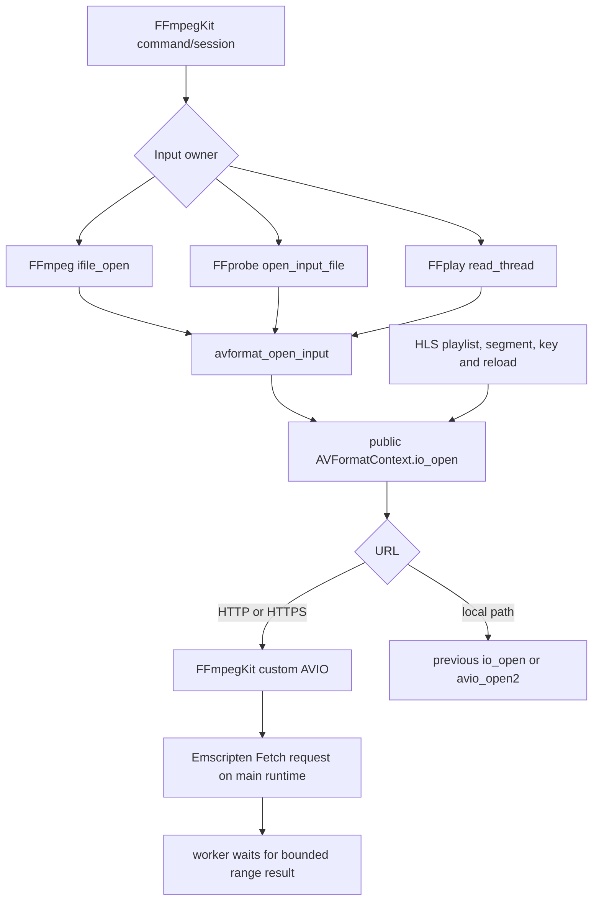

# Wasm streaming input design

This document defines the private Wasm transport and audio contracts for FFmpegKit ABI.

## Scope and ownership

- `FFmpegKit/src/ffmpegkit_wasm_http_io.c` and `.h` implement private Wasm-only input transport. They do not add a public C ABI function or an FFmpeg URLProtocol.
- `ffmpeg_demux.c`, `ffprobe.c` and `ffplay.c` install the transport on the root input `AVFormatContext` before `avformat_open_input()`.
- FFmpegKit owns the callbacks, session state, byte buffers, timeout and cancellation path. FFmpeg and SDL2 remain unchanged.
- Non-HTTP local paths continue through FFmpeg's existing `avio_open2` path. HTTP output is not supported.
- The Flutter and React Native source trees are outside this phase.

## Call path



The FFmpeg public header documents that nested `io_open` callbacks receive the same `opaque` pointer (`prebuilt/src/ffmpeg/libavformat/avformat.h`, `AVFormatContext.io_open`). Its demux path invokes `s->io_open` for root input (`libavformat/demux.c::init_input`); HLS `open_url` uses the same callback for playlists, segments and keys (`libavformat/hls.c::open_url`, `read_key`, `open_input`). HLS also asks each opened AVIO child for `location` after redirects. The custom AVIO child class exposes the effective `responseUrl` through that option so HLS can resolve relative playlist URLs from the redirected base. The helper exposes `headers` and `rw_timeout` as child options for HLS's `ffio_copy_url_options`, and keeps `withCredentials` in the per-root session for nested opens. This establishes source-level feasibility; only the built Wasm request trace can establish runtime behavior.

## Threading and request lifecycle

The AVIO callbacks are synchronous, but browser XHR is asynchronous. An HTTP open from the main Emscripten runtime thread returns `EPERM`. A pthread queues start and close work through a private `emscripten/proxying.h` queue and checks the native interrupt callback every 100 ms while waiting on a monotonic condition variable. Cancellation or expiry returns from the worker without waiting for main-thread start/close completion. Admission waiting has its own monotonic `rw_timeout` deadline. After a request acquires an in-flight slot, its Fetch wait starts a fresh `rw_timeout` deadline, so a request can spend close to two timeout intervals across admission and Fetch, plus scheduling and cleanup overhead.

Each request is heap-owned. The worker, every queued task, the live Fetch object, and each active callback own references. Requests retain the private session/budget and copy timeout, credentials, headers and URL state; late main-thread work never accesses a released AVIO or its interrupt userdata. Fetch close releases its response reservation and in-flight slot, and the last request/session reference performs final cleanup. Admission limits therefore continue to include requests whose workers have already returned. Response headers and effective URLs are allocated to their actual lengths, within the existing 8 KiB caps. Log URL buffers are 512 bytes and mark long URLs as truncated/redacted.

**Transport decision.** The transport stays on asynchronous Emscripten Fetch on the main runtime thread, hardened as described above. Synchronous Fetch from the worker was considered and rejected for two reasons:
- Emscripten sets no timeout on synchronous requests, and an in-flight request can't be aborted, so mid-request cancellation would be lost.
- Synchronous XHR delivers no progress events, so a server that ignores Range would be downloaded in full before it could be rejected, losing the memory bound.

The transport has no legacy waitable/synchronous proxy fallback and no infinite main-dependent wait. An initial queue allocation failure can be retried on the next request. Fetch close is queued onto the main runtime thread so an XHR `readystatechange` callback can return before Emscripten frees its Fetch object; closing inline from that callback can re-enter XHR cleanup and underflow the runtime keepalive count. If close queuing fails on a worker, pending main-thread work can retry. If it fails on main, a zero-delay timer owns a retained request reference and closes after the callback returns. Successful response bytes are already copied into request-owned storage, so the worker returns without waiting for main-thread destruction; delayed cleanup cannot turn those bytes into a timeout. The module retains bounded request resources until main resumes. The Fetch-start wrapper handles browser API exceptions and rethrows Wasm traps. The source is compiled with `-Wframe-larger-than=2048 -Werror=frame-larger-than` for Wasm.

The existing `FFmpegKitConfig::asyncFFmpegExecute`, `asyncFFprobeExecute` and `asyncFFplayExecute` paths create pthreads; FFplay also performs input opens on its reader thread. Synchronous FFmpeg and FFprobe entry points run on their caller's thread, so a direct HTTP open from the Emscripten main runtime returns `EPERM`. The Web adapter must use the async paths for FFmpeg/FFprobe HTTP input. This is source-level evidence; verify actual Emscripten thread identity in the Wasm harness before accepting direct URL support.

All input roots with the same nonzero FFmpegKit session ID share one resource budget: at most 8 open HTTP AVIO streams, 4 in-flight requests and a 1 MiB response-memory admission budget. Session ID zero is isolated per installed root. FFplay currently installs its HTTP session with ID zero, so its root uses an isolated budget rather than a cross-root session budget. Each stream starts with a 64 KiB range target, a 16 KiB AVIO read buffer and a 30 second interrupt timeout. Sequential reads that consume a full cache double the next range target up to 512 KiB; seeking or a nonsequential cache miss resets it to 64 KiB. Admission caps the target by the number of open streams and halves it to the largest 64–512 KiB power-of-two range that fits the remaining session budget. Each active Fetch reserves its response and the C copy separately; shorter responses shrink both reservations to the received length. A compile-time assertion guarantees that one 512 KiB response and its 512 KiB copy fit in the 1 MiB budget. Other cached ranges and active requests share the same limit. A request waits for both bytes and an in-flight slot under its monotonic admission deadline and interrupt checks; release of cached or pending bytes wakes waiters. Temporary byte contention must not fail a read with `ENOBUFS` and silently truncate a multi-input session. The implementation does not prefetch. The budget excludes the separate AVIO read buffers and browser XHR memory. Final budget release logs request count, peak accounted response bytes and remaining stream/request counts. The open log marks the worker thread identity.

### Memory scope

The 1 MiB limit accounts only for Wasm-side HTTP response storage and its C copy. It is not a cap on Wasm linear memory, browser-tab memory, or process memory. It excludes browser-owned XHR response buffers, FFmpeg demuxer/decoder and audio/video allocations, per-stream AVIO read buffers, runtime and pthread allocations, and FFmpegKit session logs. `AbstractSession::addLog` retains each session log under the existing session API; this phase does not truncate or otherwise change that behavior. A long or noisy session can therefore grow memory outside the HTTP response budget. Browser XHR memory is deliberately outside the budget and is not measured by the transport counters. Unknown-length responses that ignore Range can also allocate in browser/Wasm layers before progress-based rejection, as described below. Heap samples and zeroed request counters are diagnostic evidence only; this design makes no hard total-memory bound claim.

### Browser-controlled options

The browser controls the `User-Agent`, `Referer`, and `Cookie` request headers. The HTTP `user_agent`, `referer`, and `cookies` options are ignored; one warning lists the supplied option names without logging their values. Browser-forbidden header overrides such as `Host`, `Cookie`, `Referer`, and `User-Agent` are dropped with a warning that names the ignored header fields. Cookie-jar credentials are controlled by `withCredentials` and remain subject to browser CORS credential policy. Custom headers that the browser permits can cause a CORS preflight, so the server must allow them.

The transport sends `Range` for every HTTP read, including when `seekable=0`. That option disables FFmpeg seeking; it does not disable the transport's range request. Servers that reject Range are unsupported, except for the bounded small `200 OK` fallback described below.

**Throughput decision:** use adaptive sequential ranges, without prefetch. The per-stream target grows only after a full cache is consumed; range admission remains bounded by the shared 1 MiB response budget.

`206 Partial Content` must include a valid `Content-Range`; the browser must expose that header to the module. A small `200 OK` response that ignores Range is cached in full only when its body is at most 64 KiB; larger known-length responses abort at response headers, while unknown-length responses abort when XHR progress exceeds 64 KiB. The session budget accounts for Wasm-side response storage before starting a range and before copying an accepted response, but it does not include the browser's XHR `ArrayBuffer`. Progress events can be batched, and Emscripten may materialize a response in Wasm memory before the success callback, so the implementation does not claim a hard total-memory bound for an ignored-range response of unknown length. Truncated or malformed responses fail. The first successful response pins the resource length and captures any browser-exposed `ETag` and `Last-Modified`; later valid range responses must keep the same length, and a validator value exposed on multiple responses must remain identical. A changed length or validator fails with `EIO` before bytes from the changed response are cached. Validators hidden by browser CORS policy cannot be compared, and same-length changes without an exposed validator cannot be detected. `AVSEEK_SIZE` and absolute seek use the pinned total size. A response without exposed `Content-Range` is rejected rather than treated as seekable.

HTTP status mapping is 401/403 → `EACCES`, 404 → `ENOENT`, 416 at or beyond the known end → EOF, other HTTP errors → `EIO`, buffer limit → `ENOBUFS`, timeout → `ETIMEDOUT`, FFmpeg cancellation → `AVERROR_EXIT`, and browser network/CORS failure → `EIO`. A 416 becomes EOF only when the response exposes a valid unsatisfied `Content-Range: bytes */N` and the requested offset is at or beyond `N`; cross-origin servers must expose `Content-Range` through `Access-Control-Expose-Headers`. Missing or invalid range metadata returns `ERANGE`. Transport logs omit user information and query strings. The Wasm-only FFmpeg log callback also masks URL userinfo, queries and fragments before session logs or callbacks receive them. Header diagnostics report names without values. Successful FFprobe metadata can still contain its input filename; callers should treat returned metadata as sensitive rather than an automatically redacted log.

## Browser and server requirements

- Serve Wasm from a secure context with `SharedArrayBuffer` enabled; the host must send the COOP/COEP headers required by the Emscripten pthread build. Cross-origin resources must also satisfy the page's CORS or CORP policy.
- Allow cross-origin access with `Access-Control-Allow-Origin`. If custom headers are used, the server must allow them during CORS preflight.
- Expose `Content-Range` with `Access-Control-Expose-Headers`. `Content-Length` is also exposed by the fixture for clear test evidence.
- Redirects are followed by XHR. FFmpegKit records the final `responseUrl` for HLS child-URL resolution, while later ranges continue requesting the original URL and follow its redirect again. This preserves fresh signatures on redirect targets; it incurs one redirect for every range. Query parameters in playlist references are kept by the fixture.
- Cross-origin browser credentials use Emscripten Fetch `withCredentials`, which is inherited by nested opens in the same root. URL basic-auth fields are applied to the requested URL after percent-decoding each userinfo component once; malformed escapes and encoded NUL are rejected. Browser-controlled headers such as `Host`, `Cookie`, `Referer` and `User-Agent` cannot be forced by this transport.
- Raw TCP, RTSP, RTMP, UDP and DRM are unsupported. External HLS subtitle references are rejected by the pinned HLS demuxer. AES-128 HLS is unsupported in this Wasm build; HLS reads its key over HTTP, then the `crypto+http(s)` encrypted-segment open fails immediately with an explicit error because the transport does not implement decryption. The encrypted segment payload is not fetched.

## Local fixture

Run the fixture contract tests with:

```bash
node --test FFmpegKit/tests/wasm_streaming/server-contract.test.mjs
```

The server contract suite checks real MP4 and MPEG-TS range responses, nested signed playlist resolution, truncated/slow bodies, isolation headers and the local bundle route. The separate audio lifecycle model checks callback quiescence against a fake module; it provides supplemental evidence. The tests require loopback binding. Current execution results live in the status tracker.

The default fixture serves the repository's `FFmpegKit/tests/dummy_video.mp4`, a generated one-second PCM WAV small enough for the bounded full-response fallback, and a bundled MPEG-TS segment at `FFmpegKit/tests/wasm_streaming/fixtures/segment.ts`. A custom directory containing `progressive.mp4` and either `segment.ts` or `segment-1.ts` through `segment-3.ts` overrides those defaults. The bundled TS sample has MPEG-2 video and MP2 audio. The separate R1 H.264/AAC fixture and same-bitstream controls are under `tests/wasm_streaming/fixtures/h264-aac/`; native probe and full decode pass. The earlier Wasm TS failures were resolved by the pthread stack fix; see the R1 resolution record.

```bash
WASM_STREAMING_BUNDLE_DIR=/absolute/path/to/fresh/lib \
  node FFmpegKit/tests/wasm_streaming/server.mjs
```

The server prints its loopback URL, serves the configured local package under `/wasm/`, and sets COOP/COEP headers for pthread Wasm. Open `/wasm-acceptance.html` in a browser to run the standalone C-ABI transport matrix and the separate FFplay/live-recording checks. The transport page accepts `?case=N07` (or another case-name prefix) to run one case without the rest of the matrix; this is useful when a Wasm worker traps. The playback checks require video dimensions and an FFplay audio-device-open marker, and fail on uncaught browser errors. The live check also requires three playlist refreshes and a playback-position increase during its 30-second interval. Runs are serialized because they share one Wasm module. Use the fresh post-change package directory; the existing baseline package is not acceptance evidence. An optional positional media-fixture directory overrides the bundled samples. To exercise missing CORS, open the page as `http://localhost:<port>/wasm-acceptance.html` and set Fixture origin to the printed `http://127.0.0.1:<port>` URL.

The server supports byte ranges, bounded full responses, ignored ranges, a dropped connection, a truncated response, 301/302/307/308 redirects, valid and malformed 206 responses, 416 with exposed or absent `Content-Range`, expired signed URLs, master/variant/VOD/live/slow HLS playlists, changing live media sequences, independent slow bodies, 403/404/500, and a route without CORS headers. Its live route trims the bundled TS at a video PES boundary, then shifts PTS/DTS and PCR and advances per-PID continuity counters for each sequence. The fixture contract checks those timeline and packet-continuity invariants. The bundled MP4 has `ftyp` and MP4 sample entries; the MPEG-TS fixture has 188-byte packet sync and PAT/PMT streams for MPEG-2 video and MP2 audio. These are structural checks, not decoder validation; playback acceptance still requires running the browser/Wasm matrix. Generated fallback bodies for other routes are deterministic but are not valid media. Query `__requests` to inspect Range headers and nested URL requests.

## Audio callback and close ownership

`ffplay_lib.c` owns the Wasm audio coordinator. SDL open and close run on the main runtime thread through `emscripten/proxying.h`. An FFmpegKit `EM_JS` wrapper installs a gate around the real generated SDL ScriptProcessor handler and its suspended-context silence timer. Each audio generation has its own callback depth, closing flag and pending close completion.

Close marks that generation closing. Retained handlers then fill their supplied output buffer with silence and return before reaching SDL or native audio userdata. If a callback is active, `emscripten_proxy_sync_with_ctx` holds native close and its userdata alive; callback exit runs the deferred close exactly once and calls `emscripten_proxy_finish`. Otherwise the main-thread close completes immediately. A reopened device receives a fresh audio generation. This mechanism lives inside the module; a Phase 2 Promise or framework audio helper is unnecessary.

The coordinator relies on SDL 2.32.8's private `Module.SDL2.audio` state. An unavailable handler emits `audio_gate_unavailable`; any SDL upgrade must repeat the real generated-SDL lifecycle checks. Bounded lifecycle markers identify playback/audio generation, device ID, open/close and terminal events. The standalone acceptance suite checks EOF, stop, repeated playback, codec/sample-rate transition, pause/resume, duplicate stop, rapid device reopen and retained stale generated handlers. The fake-module `audio-close-contract` model is supplemental and does not establish generated-SDL correctness.

## Runtime integration requirements

FFmpeg's existing `AVERROR_EXIT` to return-code 0 mapping is intentional for host application stability and remains in Emscripten. A cancelled HTTP command must interrupt transport, release resources, deliver one terminal completion callback, and leave the web app able to execute subsequent commands. Return code 0 alone does not establish that cancelled media processing completed. FFprobe retains its existing cancellation result. The diagnostic completion observer registers real callbacks through the public async APIs; its helpers are absent from production.

Use the existing async FFmpeg/FFprobe execution exports for HTTP input, a module-local canvas and lifecycle, the packaged pthread worker/loader, and the existing callback/handle ownership rules. Serve the generated loader unchanged. Keep its module alive until sessions and their cleanup complete. Native FFplay uses its reader pthread. The runtime requires `SharedArrayBuffer`, cross-origin isolation and the browser/server policies described above.
